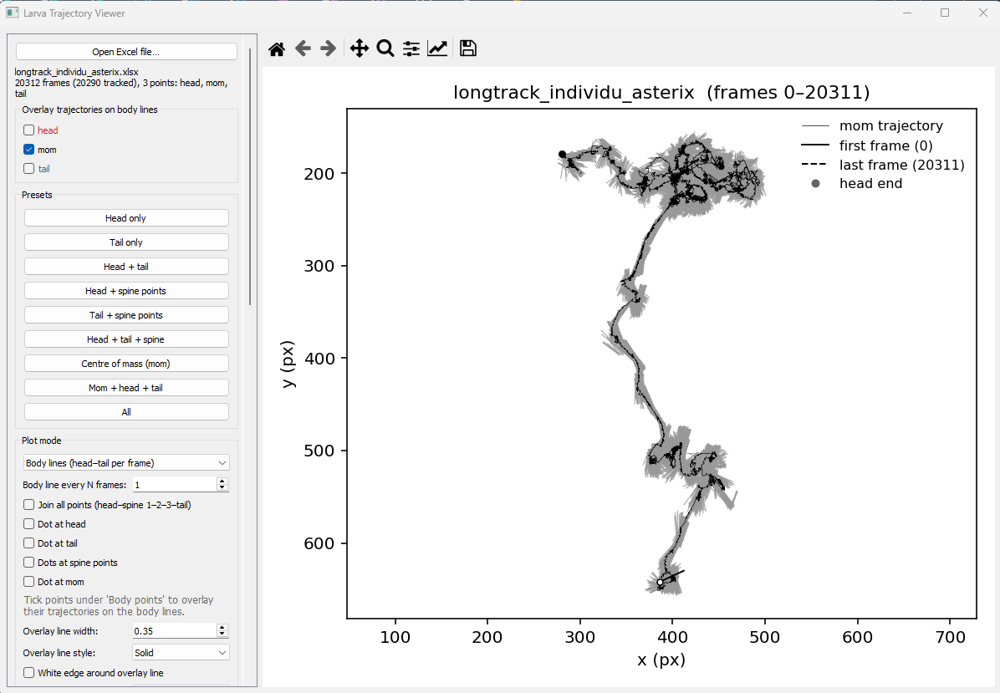

# Larva Trajectory Viewer



A small desktop GUI (PyQt5 + matplotlib) for plotting the x/y trajectory of a single
*Drosophila* larva from an Excel tracking export (e.g. FIM-Track). You can plot the path of
any body point (head, tail, centre of mass, spine points), or draw the larva's body as a
head–tail line in every frame. Then you can adjust colours, units, rotation and axes, and
export the figure as a publication-ready vector PDF.

---

## Contents

- [Installation](#installation)
- [Running the viewer](#running-the-viewer)
- [Input file formats](#input-file-formats)
- [How to use](#how-to-use)
  - [1. Load a file](#1-load-a-file)
  - [2. Choose a plot mode](#2-choose-a-plot-mode)
  - [3. Choose body points](#3-choose-body-points)
  - [4. Body lines options](#4-body-lines-options)
  - [5. Time](#5-time)
  - [6. Spatial calibration](#6-spatial-calibration)
  - [7. Display options](#7-display-options)
  - [8. Axis range](#8-axis-range)
  - [9. Export a PDF](#9-export-a-pdf)
- [Recipes](#recipes)
- [Notes and limitations](#notes-and-limitations)

---

## Installation

You need Python 3.8 or newer.

```bash
git clone https://github.com/<your-account>/larva-trajectory-viewer.git
cd larva-trajectory-viewer

# optional but recommended: a virtual environment
python -m venv .venv
# Windows:      .venv\Scripts\activate
# macOS/Linux:  source .venv/bin/activate

pip install -r requirements.txt
```

Dependencies: `PyQt5`, `matplotlib`, `numpy`, `pandas`, `openpyxl`.

## Running the viewer

```bash
python larva_trajectory_gui.py                     # then use "Open Excel file…"
python larva_trajectory_gui.py path/to/larva.xlsx  # open a file directly
```

---

## Input file formats

The viewer reads the **first sheet** of an `.xlsx`/`.xls` file. It recognises two layouts
automatically.

**Layout A: point blocks.** The first row has a point name followed by `x` and `y`
columns, repeated for each point:

| mom | x | y | head | x | y | spinepoint_1 | x | y | … | tail | x | y |
|-----|---|---|------|---|---|--------------|---|---|---|------|---|---|
| …   |412|705| …    |418|702| …            |…  |…  | … | …    |…  |…  |

**Layout B: one column per coordinate.** Column headers end in `_x` / `_y`, optionally
with a larva ID in front. A `timepoint`, `time` or `frame` column is ignored.

| timepoint | larva(926)_head_x | larva(926)_head_y | larva(926)_mom_x | larva(926)_mom_y | larva(926)_tail_x | larva(926)_tail_y |
|-----------|------|------|------|------|------|------|
| 0         | 391  | 170  | 380  | 179  | 365  | 182  |

- Recognised point names: `head`, `tail`, `mom` (centre of mass), and `spinepoint_1`,
  `spinepoint_2`, `spinepoint_3`. Other names are loaded too and can be plotted as
  trajectories.
- If a layout-B file contains **several larvae** (different prefixes), a **Larva**
  drop-down appears under the file name so you can choose which one to plot.
- Empty cells are treated as untracked frames. Lines break at gaps rather than jumping
  across them, and empty rows at the end of the file are trimmed.

---

## How to use

All controls are in the scrollable panel on the left. The plot updates immediately. The
matplotlib toolbar above the plot lets you pan, zoom and reset the view.

### 1. Load a file

Click **Open Excel file…**. The panel shows the file name, the number of frames (and how
many are tracked), and which points were found.

### 2. Choose a plot mode

**Plot mode** → choose one:

- **Trajectories (points over time):** draws the path of each ticked body point across
  the selected frames.
- **Body lines (head–tail per frame):** draws one line per frame from head to tail. Lines
  from different frames are not joined, so you see the body's position and orientation
  over time.

### 3. Choose body points

The top box lists the points in the file. Its meaning depends on the mode:

| Mode | Top box title | Ticked points are… |
|------|---------------|--------------------|
| Trajectories | *Body points* | drawn as trajectories |
| Body lines   | *Overlay trajectories on body lines* | drawn as trajectories **on top of** the body lines |

Each mode remembers its own ticks. Body lines mode starts with only **mom** ticked, so the
centre-of-mass path is shown over the body lines.

The **Presets** buttons set the ticks in one click: *Head only*, *Tail only*,
*Head + tail*, *Head/Tail + spine points*, *Head + tail + spine*,
*Centre of mass (mom)*, *Mom + head + tail*, *All*.

### 4. Body lines options

These are in the **Plot mode** box and are active in Body lines mode.

| Control | What it does |
|---------|--------------|
| Body line every N frames | Draw a line every N frames (1 = every frame). Increase for long recordings. |
| Join all points (head–spine 1–2–3–tail) | Off: straight head–tail line. On: line through every body point, showing body bending (needs spine points in the file). |
| Dot at head / tail / spine points / mom | Put a small circle at that point on every body line. |
| Overlay line width / style | Width (0.1–20) and style (solid, dashed, dotted, dash-dot, long dash, fine dots) of overlaid trajectories, e.g. mom. |
| White edge around overlay line | Adds a contrasting edge so the overlay stands out over dense body lines. It turns black automatically for light line colours. |
| Mom line colour | Black, greys, white, blue, navy, red, orange, magenta, purple, teal, or **Custom…** (colour picker). Used in both modes. |
| Dot size | Size of the per-line dots. |
| Open circles (white fill) | Draw dots as open circles. |
| Dot colour | *Head red / tail blue* keeps the two ends distinguishable. *Same as line (time)* shades the dots by frame. |

### 5. Time

| Control | What it does |
|---------|--------------|
| Frames per second | Your recording's frame rate. |
| Show time as | *Frames*, *Seconds* or *Minutes*. Converts the colour bar, the plot title and the first/last-frame legend labels. |

A readout under the box always shows the selected frame range in seconds and its
duration. The Start/End frame boxes are always entered in frames.

### 6. Spatial calibration

| Control | What it does |
|---------|--------------|
| x: pixels per cm / y: pixels per cm | Your known conversion factors, set separately for x and y. |
| Use the x factor for y as well | Tick this if the factors are the same. |
| Show axes in | *px* (raw), *cm* or *mm*. Converts all coordinates, axis labels and the Axis range box. |

A readout shows what one pixel equals in mm, as a sanity check. Calibration is applied
**before** rotation, so each factor stays tied to the camera's own x or y axis.

### 7. Display options

| Control | What it does |
|---------|--------------|
| Colour | *By body point* (fixed colours) or *By time (frame)* (viridis colour scale with colour bar). |
| Body line colour | Colour of the body lines in *By body point* mode: grey (default), black, other preset colours, or **Custom…**. |
| Body line opacity | 0.05–1. Lower values keep dense regions from becoming solid. |
| Body line width | Width of the per-frame body lines. |
| Start frame / End frame | Plot only part of the recording. |
| Draw body skeleton (every N frames) | Bold head→spine→tail outline every N frames. It sits under the trajectories in Trajectories mode and over the lines in Body lines mode. |
| Start / end markers | Trajectories: open circle at the start, filled square at the end. Body lines: the first frame's line is solid and the last frame's is dashed, each with a dot at the head. |
| First/last line width, Start/end marker size | Size of those markers. |
| Image coords (flip y) | y increases downwards, as in the camera image (default on). |
| Rotate | 0°, 90° clockwise, 180°, 90° anticlockwise, as seen on screen. Rotates everything about the centre of the track. |
| Equal aspect | Keeps 1 unit in x the same length as 1 unit in y. |
| Legend / Closed box / Show axes | Toggle the legend, the top/right frame lines, and the axes. |
| Line width | Width of trajectories in Trajectories mode. |
| Title | Custom title. If empty, the file name is used. The frame (or time) range is always appended. |

### 8. Axis range

- **Auto** (default) fits the data.
- Untick **Auto** to type **x min / x max / y min / y max** in the current unit.
- **Use current view:** zoom with the toolbar's magnifier, then press this to lock that
  zoom so it is kept for further changes and for the PDF.

Changing the calibration unit or factors switches back to Auto, because the old limits
would be in the wrong unit.

### 9. Export a PDF

Click **Export PDF…**. The figure is saved exactly as shown, as a vector PDF with
editable text (fonts embedded as TrueType, so it opens cleanly in Illustrator or
Inkscape). The suggested file name reflects the mode, e.g.
`Larvea_0_trajectory_head-tail.pdf` or `longtrack_individu_asterix_bodylines_head-tail.pdf`.

The toolbar's save icon can also save PNG/SVG/etc.

---

## Recipes

**Body lines in black with a red centre-of-mass path**
1. Plot mode → *Body lines*.
2. Colour → *By body point*; Body line colour → *Black*; opacity ≈ 0.3–0.5; width ≈ 0.3.
3. Top box: tick **mom** only; Mom line colour → *Red*; Overlay line width ≈ 0.6.

**Time-coloured posture plot of the first minute**
1. Frames per second → your frame rate; Show time as → *Seconds*.
2. Start frame 0, End frame = fps × 60.
3. Plot mode → *Body lines*; Colour → *By time*; tick *Join all points* and *Dot at head*.

**Head, tail and centre of mass in cm**
1. Enter pixels-per-cm for x and y; Show axes in → *cm*.
2. Plot mode → *Trajectories*; preset *Mom + head + tail*; Colour → *By body point*.

---

## Notes and limitations

- Only the first sheet of the workbook is read.
- With **Colour = By time** in Trajectories mode, all points share one colour scale, so
  use *By body point* to tell mom/head/tail apart.
- Files without spine points still work: *Join all points* and spine dots then have no
  effect.
- A white mom line is clear on the plot but its legend entry is white on white. Turn
  off the legend or use a different colour for that figure.
- Very long recordings at *Body line every N frames = 1* draw tens of thousands of lines.
  This is fine for PDFs, but a larger N redraws faster while you adjust settings.
